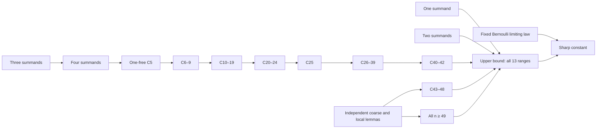

# The iid Berry–Esseen constant

**Mathematical argument, exact certificates, and public replay tools.**

[Read the paper](paper/main.pdf) · [TeX source](paper/main.tex) ·
[Detailed analytic derivations](paper/analytic-supplement.txt) ·
[Certificate downloads](../../releases/tag/v0.1.0)

For centered, variance-one iid real random variables with finite
`rho = E|X|³`, the target is

$$C_* = \sup_{n\ge1}\sup_P\frac{\sqrt n\,\Delta_n(P)}{\rho(P)}
=\frac{3+\sqrt{10}}{6\sqrt{2\pi}}.$$

The paper supplies the exact definitions, the independent lower approximation,
the same-law induction, physical resource/count reduction, and the finite and
unbounded-tail composition. The supplement contains the longer ordinary proofs
and a lemma-to-source index. Full analytical formalization in Lean is future work.

## Verification status

This is the **v0.1 working publication**, released on 27 October 2026.
The selected numerical campaign has completed. The analytical and active-checker
source audit is closed, with no identified unresolved mathematical/source gap.
The audit was performed by separate AI review agents and is not external human
peer review. **A complete public end-to-end `full_pass` has not yet been established.**
The paper retains explicit numerical hypotheses; an audit, hash, saved success
label, individual checker, or COUNT batch is not substituted for the full result.

The fresh public COUNT recheck is running separately. This release does not
pretend that the remaining providers have already been integrated and replayed.
The default full command deliberately returns `INCOMPLETE` until that is true.

## Start here

Use Python 3.12. The small exact check needs only the standard library:

```sh
python -I -B be.py status
python -I -B be.py verify --n1
```

Download and freshly verify all **1243** selected COUNT candidates:

```sh
python -I -B tools/fetch_certificates.py --counts
python -I -B be.py verify --counts --jobs 4
```

Candidate data are untrusted. Original unchanged native checkers reconstruct
their closed trees and recompute every leaf. Saved PASS files are never accepted
as substitutes. `--resume` reuses candidate downloads and reruns the checks.
Large datasets are GitHub Release assets rather than Git history; the checked-in
release manifest records each exact size and SHA-256.

The resources branch provides complete original task DAGs for 16 declarations:

```sh
python -I -B be.py verify --task indexed40
```

See [resource tasks](verification/resources/README.md) and
[G2/G3/ROOT4 stages](verification/foundations/README.md) for the exact supported
commands. G3 requires `g++` and Boost; the guarded full ROOT4 path requires Linux.
The scientific source programs use NumPy 1.26.4 and SciPy 1.13.1.

The main CLI also runs these complete original foundation stages directly:

```sh
python -I -B be.py verify --foundation n2-primary --timeout 7200
python -I -B be.py verify --foundation n2-independent --timeout 7200
python -I -B be.py verify --foundation n3-full --timeout 7200
python -I -B be.py verify --foundation root4-two-pass --timeout 43200
```

Each run requires a fresh output directory and records its own native execution.
Verifying one stage does not assert the complete theorem.

```sh
python -m pip install -r requirements.txt
python -I -B tools/fetch_certificates.py --all
```

The latter also downloads 16 families of preserved mathematical witnesses,
including actual20, resource/support stages, both unrestricted HIGH families,
and finite40–42 acquisition/LOW material. Original mathematical bytes are retained;
private machine records, authority keys and personal credentials are excluded.
Some older resource/finite/tail public adapters still need integration. Availability
of bytes is reported separately from completion of a numerical verification.

The [finite and tail adapter](verification/finite-tail/README.md) also provides
all 183 finite numerical parent tasks and the original 55-invocation tail suite:

```sh
python -I -B be.py verify --finite-tail finite-all --jobs 4 --timeout 64800
# Linux, with sufficient memory and an explicit execution budget:
python -I -B be.py verify --finite-tail tail-full --timeout 64800
```

These are substantial computations. Two final finite collectors still require
their current parent joins; the numerical parents alone do not close that case.

The [earlier resource adapter](verification/legacy-resources/README.md) adds
128 runnable original tasks for C5, C6–9 and C10–19. Its portable exact scalar
check can be run without a cloud account:

```sh
python -I -B verification/legacy-resources/legacy_resources.py run \
  --task shared.kappa62_625 --output verification-results/legacy-scalar
```

Its remaining resource controllers require Linux; dependency directories are
explicit inputs. The adapter lists the older branches and final joins it does
not yet cover, including one blocked historical controls route.

The [actual20 source API](verification/actual20/README.md) exposes the original
41-step protocol for **n = 20**, plus a complete portable five-contract scalar
replay. Here 41 counts operations, not the number of summands:

```sh
python -I -B verification/actual20/replay.py scalar \
  --output verification-results/actual20-scalar --timeout 120
```

Its exact source cache, source epochs and original input capsule are included.
Bridging the new public COUNT/Fourier outputs to the full original stage protocol
and porting the final continuation epochs remain explicit integration work.
The selected 1243-job COUNT batch covers C5, C6–9, C10–19 and C26–39. It does
**not** contain the 49 n=20 jobs required by this original stage API; those need
a separate public execution path. Completing the 1243-job batch alone therefore
does not discharge the n=20 COUNT obligations.

## Proof dependencies



Every finite index 1–48 and the unbounded tail from49 has an explicit role in
the [global mathematical contract](mathematics/global-contract.json).
The manuscript states all intermediate hypotheses and does not assume index
monotonicity, finite attainment of the sharp global constant, or a sharp42→43 edge.

## Contents

* `paper/`: compiled preprint, editable TeX, longer proof source and lemma index.
* `mathematics/`: exact global contract and bounded source-audit reports.
* `verification/`: public original-checker replay implementations and source packs.
* `certificates/`: public candidate/release manifests; large blobs are release assets.
* `source/original/`: unchanged selected mathematical source closure, with SHA manifest.
* `formal/`: conditional Lean proof interfaces, not a claimed full formalization.

No cloud account, private authority key or historical campaign token is required
by the public replay commands. Historical paths in unchanged source notes are
provenance, not instructions to obtain another user's credentials. Operational
dashboards and private caches are not part of this repository.

Code is MIT licensed. The manuscript states the scope of AI assistance.

The additional `INITIAL_CAPSULE.zip` release asset is the exact original mathematical input for the actual20 continuation. The downloader retains its original bytes at `.be/downloads/INITIAL_CAPSULE.zip` and also extracts its source contents. It was screened for private-key material before publication.
