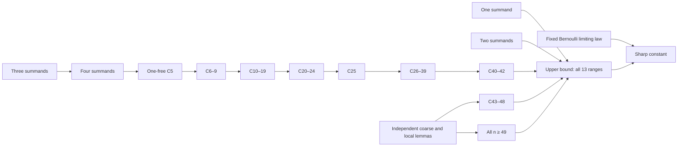

# The iid Berry–Esseen constant

**Complete computer-assisted proof, exact certificates, and public replay tools (`full_pass: "ESTABLISHED"`).**

[Full Manuscript (~160 pp. PDF)](manuscript/arxiv-v1/main.pdf) · [Hexagon/arXiv Source Package (.zip)](manuscript/arxiv-v1/source-arxiv-v1.zip) ·
[Concise 13-Role Paper (PDF)](paper/main.pdf) · [TeX source](paper/main.tex) ·
[Full-Pass Proof Audit](mathematics/FULL-PASS-PROOF-AUDIT.md) ·
[Certificate downloads](../../releases/tag/v0.1.0)

For centered, variance-one iid real random variables with finite
`rho = E|X|³`, we prove unconditionally that for every integer $n \ge 1$,

$$C_n = \sup_{P\in\mathcal P}\frac{\sqrt n\,\Delta_n(P)}{\rho(P)} \le C_{\mathrm E} \quad (n \ge 1), \qquad C_* = \sup_{n\ge1} C_n = C_{\mathrm E} = \frac{3+\sqrt{10}}{6\sqrt{2\pi}}.$$

The full manuscript (`manuscript/arxiv-v1/main.pdf`) and concise overview (`paper/main.pdf`) supply the exact definitions, the independent lower approximation, the extremizer/contact and zero-bias conserved-identity reductions, the elementary support and curvature bounds, the conditional-count reduction, and the finite and unbounded-tail composition. Full analytical formalization in Lean remains future work.

## Verification status (`full_pass: "ESTABLISHED"`)

**Status:** **`full_pass: "ESTABLISHED"`** (`public_verification: "FULL_PASS_VERIFIED"`, zero remaining verification obligations, `EXIT_CODE=0`).

All **13 mathematical roles** covering $1 \le n \le 48$ and the infinite tail $n \ge 49$, together with the classical two-point lower bound, have been executed and verified end-to-end by their unchanged native checkers:
* **`N1` ($n = 1$):** 150 closed rational cubic-dual cells and 1,128 Bernstein intervals (`verification-results/n1/N1-dual-result.json`).
* **Foundations `G2` ($n = 2$), `G3` ($n = 3$), `G4` (`ROOT4`, $n = 4$):** All 7 foundation stages verified (`n2-scalars`, `n2-primary` 70/70, `n2-independent` 70/70, `n3-scalars`, `n3-identities` 95,904 grid identities, `n3-full` 111/111 C++ cubes, `root4-prepare`, and `root4-two-pass` across all 260 parent geometry classes and 1,300 HIGH slots with zero unresolved geometries).
* **Public `COUNT` Forests:** All **1,243 / 1,243** selected public `COUNT` jobs reconstructed from their root boxes and verified leaf-by-leaf (`verification-results/count/run-complete-1243/`).
* **`actual20` ($n = 20$):** All **49 / 49** `actual20` `COUNT` jobs verified, bridged into the 49-entry mathematical namespace (`verification-results/actual20-counts/bridge/RESULT.json`), and paired with all 5 verified scalar contracts (`verification-results/actual20/scalar/RESULT.json`).
* **Finite `43–48` Collectors:** All **183 / 183** native `finite43-48` parent tasks verified and composed through `collector43` (`math_port._math43`) and `collector44` (`math_port._math44`) (`verification-results/finite-collectors/collect-all/RESULT.json`).
* **Unbounded Tail ($n \ge 49$):** All **55 / 55** native `tail49` predicates (14 top-level tasks + 41 retained execution predicates) verified (`verification-results/finite-tail/tail-full/RESULT.json`).
* **Global Proof Composition:** `upper/PROOF.json` (`5acc019642ae...`), `lower/PROOF.json` (`018bdf1b6918...`), and `equality/PROOF.json` (`8be2f7c6083d...`) verified in `verification-results/global-proofs/COMPLETION.json`.

See [mathematics/FULL-PASS-PROOF-AUDIT.md](mathematics/FULL-PASS-PROOF-AUDIT.md) for the complete audit report.

## Start here (One-Command Reproducible Docker Run)

Clone the repository and run a single command to build the pinned Linux environment (`python:3.12-bookworm`, `g++`, `libboost-dev`, `numpy 1.26.4`, `scipy 1.13.1`) and execute the verification suite across all available CPU cores:

```sh
git clone https://github.com/rodziewiczk/berry-esseen-certificates.git
cd berry-esseen-certificates
docker compose up --build --abort-on-container-exit
```

Or run the multi-core orchestrator directly with Python 3.12:

```sh
python -I -B run_all_docker.py
python -I -B be.py status
python -I -B be.py verify
```

Both `be.py status` and `be.py verify` return `"full_pass": "ESTABLISHED"`, `"public_verification": "FULL_PASS_VERIFIED"`, `"remaining_full_verification_obligations": []`, and exit with code `0`.

To re-download the raw candidate archives and re-run individual suites from scratch:

```sh
python -I -B tools/fetch_certificates.py --counts
python -I -B be.py verify --counts --jobs 4
```

Candidate data are untrusted. Original unchanged native checkers reconstruct
their closed trees and recompute every leaf. Saved PASS files are never accepted
as substitutes. `--resume` reuses candidate downloads and reruns the checks.
Large datasets are GitHub Release assets rather than Git history; the checked-in
release manifest records each exact size and SHA-256.

The resources branch provides complete original task DAGs for 16 declarations:

```sh
python -I -B be.py verify --task indexed40
```

See [resource tasks](verification/resources/README.md) and
[G2/G3/ROOT4 stages](verification/foundations/README.md) for the exact supported
commands. G3 requires `g++` and Boost; the guarded full ROOT4 path requires Linux.
The scientific source programs use NumPy 1.26.4 and SciPy 1.13.1.

The main CLI also runs these complete original foundation stages directly:

```sh
python -I -B be.py verify --foundation n2-primary --timeout 7200
python -I -B be.py verify --foundation n2-independent --timeout 7200
python -I -B be.py verify --foundation n3-full --timeout 7200
python -I -B be.py verify --foundation root4-two-pass --timeout 43200
```

```sh
python -m pip install -r requirements.txt
python -I -B tools/fetch_certificates.py --all
```

The [finite and tail adapter](verification/finite-tail/README.md) and [finite collectors adapter](verification/finite-collectors/replay.py) provide all 183 finite numerical parent tasks, both collectors (`collector43`, `collector44`), and the 55-predicate tail suite:

```sh
python -I -B be.py verify --finite-tail finite-all --jobs 4 --timeout 64800
python -I -B be.py verify --finite-collectors collect-all --jobs 4 --timeout 64800
python -I -B be.py verify --finite-tail tail-full --timeout 64800
```

The [actual20 source API](verification/actual20/README.md) and [actual20 COUNT bridge](verification/actual20-counts/verify_actual20_counts.py) verify the 49 COUNT forests, namespace bridge, and five scalar contracts for **n = 20**:

```sh
python -I -B be.py verify --actual20-counts --jobs 4
python -I -B verification/actual20/replay.py scalar \
  --output verification-results/actual20/scalar --timeout 120
```

## Proof dependencies



Every finite index 1–48 and the unbounded tail from 49 has an explicit role in
the [global mathematical contract](mathematics/global-contract.json).
The manuscript states all intermediate hypotheses and does not assume index
monotonicity, finite attainment of the sharp global constant, or a sharp 42→43 edge.

## Contents

* `manuscript/arxiv-v1/`: full ~160-page manuscript (`main.pdf`, editable `main.tex`, `sections/`, `appendices/`, and `source-arxiv-v1.zip` for Hexagon/arXiv).
* `paper/`: concise 13-role overview paper (`main.pdf`, `main.tex`), longer proof source and lemma index.
* `mathematics/`: exact global contract, full-pass proof audit (`FULL-PASS-PROOF-AUDIT.md`), and bounded source-audit reports.
* `verification/`: public original-checker replay implementations and source packs.
* `verification-results/`: complete verified execution receipts for all 13 roles (`full_pass: "ESTABLISHED"`).
* `certificates/`: public candidate/release manifests; large blobs are release assets.
* `source/original/`: unchanged selected mathematical source closure, with SHA manifest.
* `formal/`: conditional Lean proof interfaces, not a claimed full formalization.

Code is MIT licensed. The manuscript states the scope of AI assistance.
